# synthlab

**A hackable synthesizer and music studio you can read end to end.** A
synthesis engine in NumPy with Rust kernels, and a browser-based
workstation built on it: design sounds, program drums, record loops,
arrange and mix whole songs, and export them. All on your own machine,
with no samples, no plugins and no cloud.

<a href="docs/media/synthlab-reel.mp4">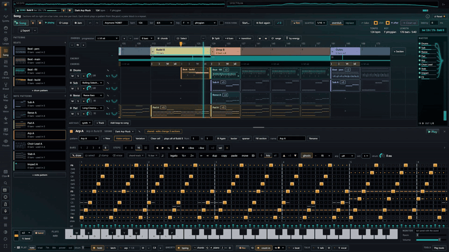</a>

▶ **[Watch the 35-second reel with sound](docs/media/synthlab-reel.mp4)**: every sound in it was made
in synthlab, a song generated by its Start a song button.

## Why I made it

synthlab is a side project I've been building for fun over the last month
or so. I needed something different. Back in the day I spent hours in
Fruity Loops, and the part I loved most was making sounds with synths.

I work in software and lead an AI team, so yes, of course AI helped. But
for me AI is a hammer: I use it to build the tools, not the other way
round.

This is what keeps my head clear and my ADHD brain busy. I deliberately
went against clean, modern and simple, and chose over-the-top, technical
fun instead. It's wired into my Stream Deck so the dials and the touch
strip drive it, it has nearly 300 sounds, and there are heaps of pages and
corners to muck around in. I tried getting back into Fruity Loops and found
it lacking with a mouse, a keyboard and the Surface pen (on my ARM64
Surface), so I made my own.

Under the hood it's Rust and Python; the front end is just HTML, CSS, a
little JavaScript and htmx 4.

It's a fair bit of hot garbage at the moment, but it's my hot garbage. It
sounds great, and there are some genuinely interesting sounds in there.

> **Alpha (0.1.0a1).** It works and it is tested (about 10,000 tests), but it
> is young: expect rough edges, changing layouts and saved-state migrations
> between versions. It is developed and run in CI on **Windows (x64 and
> ARM64)**; other platforms are untested (see [Install](#install)).

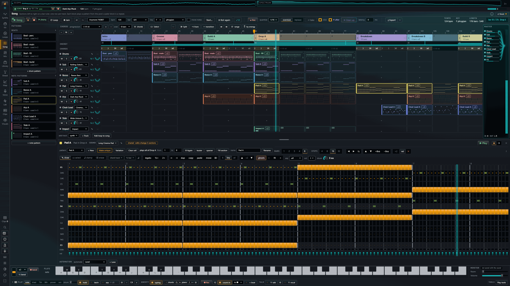

## What's in it

Every sound is computed from maths you can see and change. The engine
(`synthlab/`) is a plain Python library. The studio (`synthlab/studio/`)
is a FastAPI server that renders the pages, uses htmx for interaction, and
plays live notes through an AudioWorklet voice compiled to WebAssembly
SIMD. What you hear while you play is exactly what an export writes.

| Page | What you do there |
|---|---|
| **Synths** | Design a sound. Oscillators (saw, square, triangle, sine, supersaw, noise, FM, 4-operator FM, Karplus-Strong pluck, morphable wavetables — your own too — and a sampler with zones), a ladder / state-variable filter, a vowel filter, envelopes, LFOs, a mod matrix, macros, per-note curves on any knob, A/B compare, four stacked layers, and an FX chain from 47 units. |
| **Kit** | The drum machine: synthesized kits (no samples), a step sequencer where each hit has its own velocity, chance, ratchet, nudge and tune, per-row swing, variations A–D, fills, Euclidean rhythms, a mini-notation (`bd*4 [~ sn] hh*8`) and 54 beat styles. |
| **Loops** | Perform and record. Note and drum grids, a piano roll, a chord lane, ⏺ Rec that keeps what you played as audio *and* as an editable loop, quantise, a launcher of loops and scenes, and → Song. |
| **Song** | Arrange: a playlist of patterns on a bar ruler, drag and copy, cut / unroll / insert bars, automation lanes (levels, sound parameters, FX parameters), meter and tempo changes (3/4, 6/8, 7/8, ramps), a clip launcher whose quantised jams become sections, recorded takes with count-in, risers and impacts. **Start a song** writes a whole arrangement in one click, in 18 styles, from a chord track. |
| **Mix** | A strip per track (level, pan, sends, duck, EQ), returns, a master strip with live integrated / short-term LUFS, true peak, correlation, loudness range, a spectrum and a goniometer — reading the same as the export's measurement. |
| **Library · Breed · Map** | 96 library sounds plus the factory bank; breed new sounds from parents (each child shows what changed); a map of the whole sound space to wander. |
| **Voice** | A vocoder and a vocal booth: record or load a take, treat it (pitch correction, harmony, de-esser, doubler, compression…), vocode it against four carriers. |
| **Lab** | The Sample Lab: bring in a song, detect its tempo and key, separate it into stems (an on-device model, downloaded on first use), cut chops and send them anywhere. |
| **Clips** | Every clip and sample in one place: listen, tune, send to a track or the sampler, and make a beat, notes or a sound from a clip. |
| **Visuals** | Full-screen visualisers of what is playing. |

Exports: WAV, FLAC and MP3 at a loudness target, per-track stems, MIDI
files, and a one-file project (`/project.zip`).

Play it with the computer keyboard (a full typing-keys layout), a
pen with pressure, **Web MIDI** controllers (MIDI learn on any control),
or an **Elgato Stream Deck +** over WebHID (dials, keys and a touch strip
mapped to the page you are on). A command palette (Ctrl+K) lists every
action.

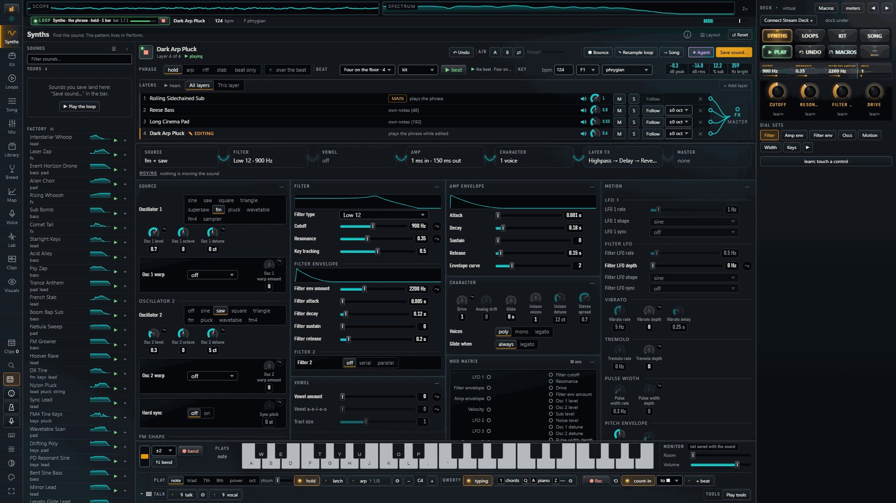

With no hardware plugged in, the same deck runs on screen (the rail's
deck button): it is drawn by the same code, so it looks and behaves the
same. With a Stream Deck + connected over WebHID, its keys, dials and
strip show what you see here.

<table>
<tr>
<td>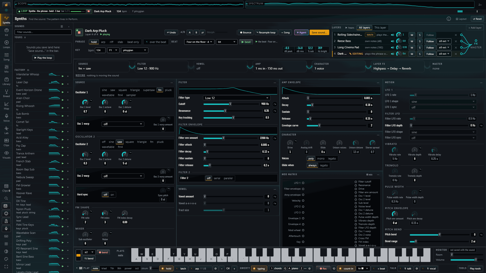</td>
<td>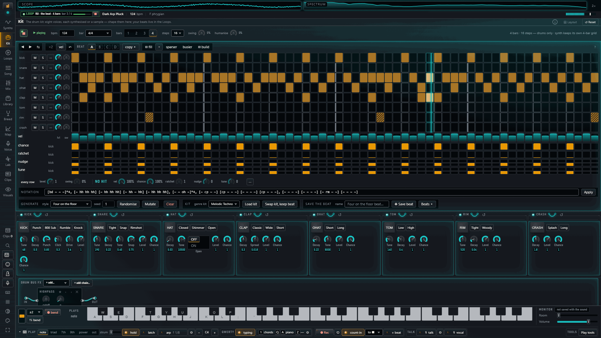</td>
</tr>
<tr>
<td>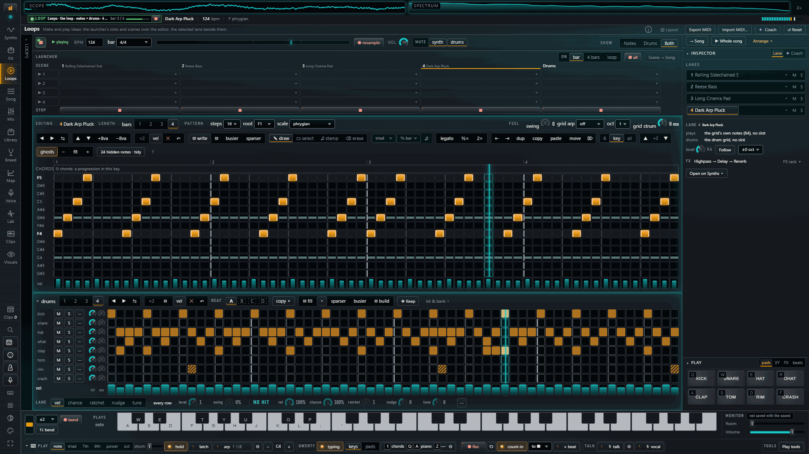</td>
<td>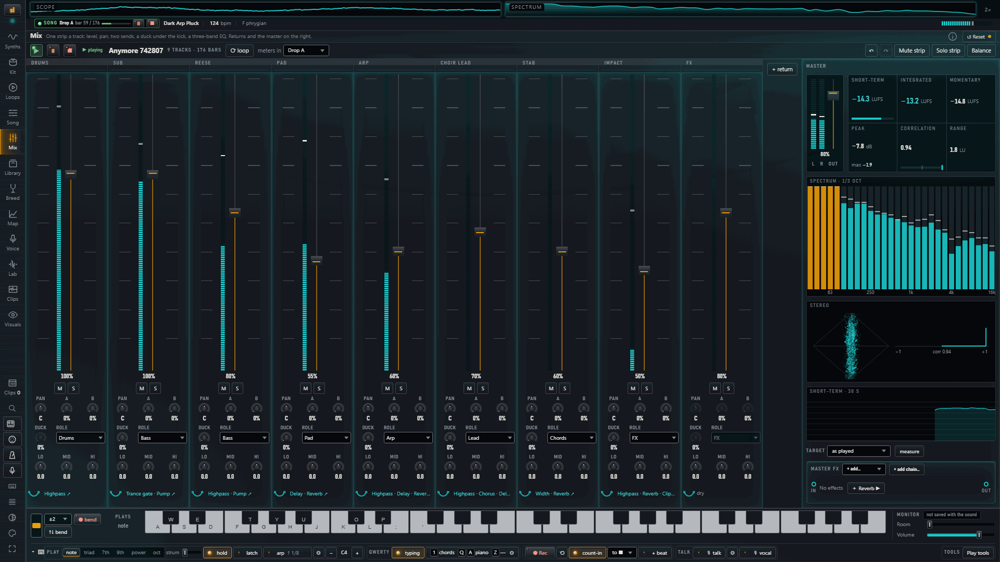</td>
</tr>
<tr>
<td>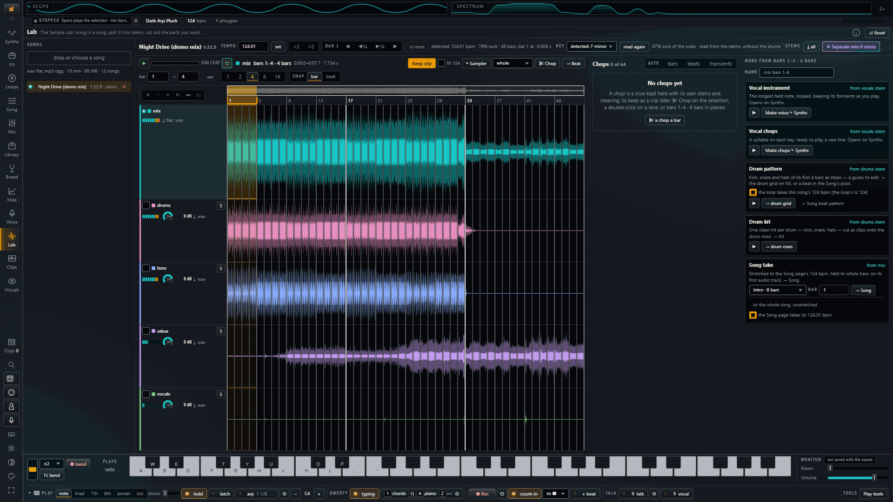</td>
<td>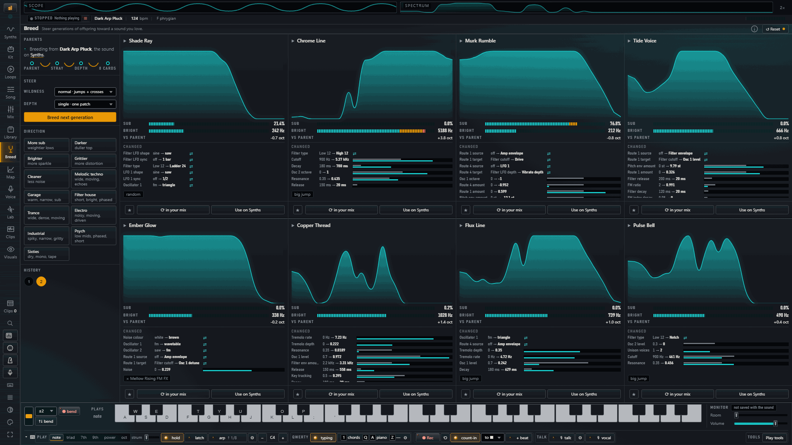</td>
</tr>
<tr>
<td>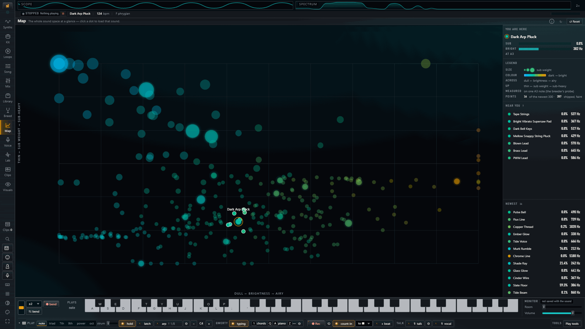</td>
<td>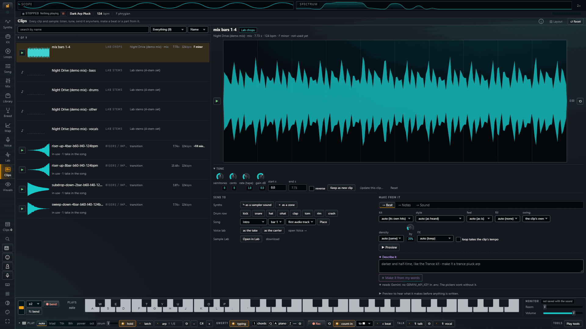</td>
</tr>
<tr>
<td>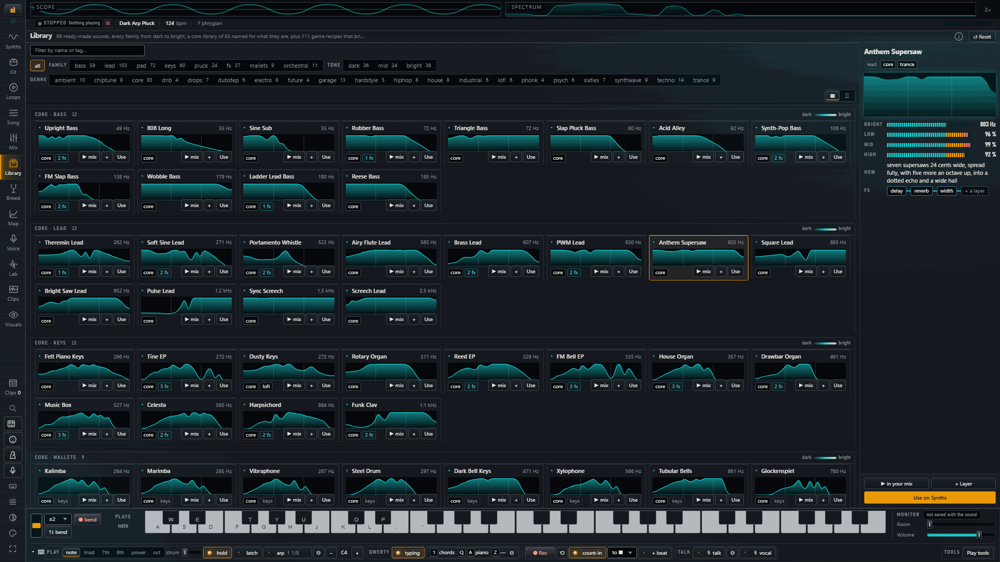</td>
<td>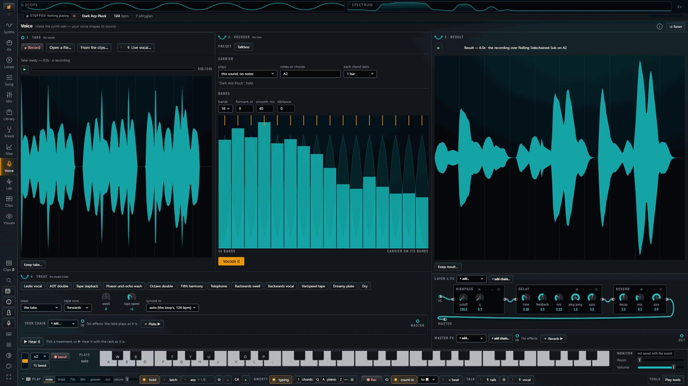</td>
</tr>
<tr>
<td>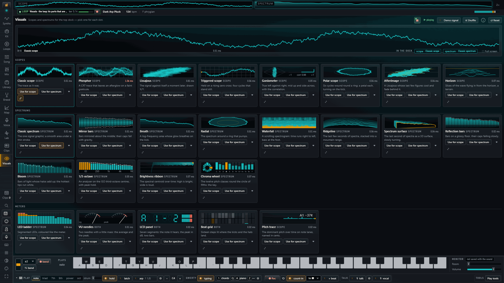</td>
<td>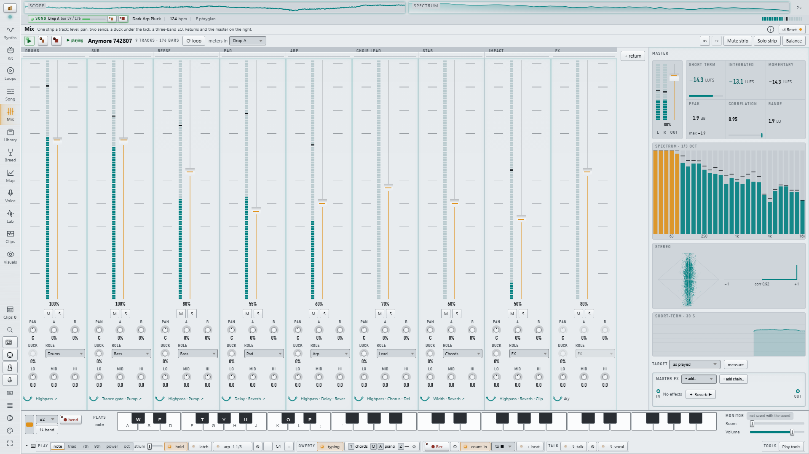</td>
</tr>
</table>

Two themes: a dark "night" theme and a brushed-aluminium "day" theme.

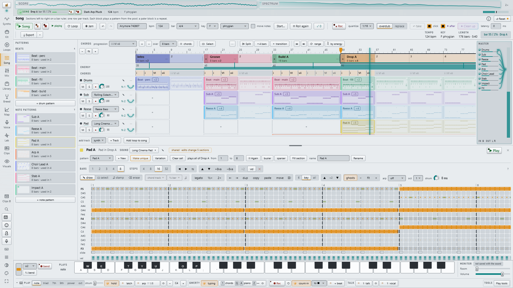

## Install

You need [uv](https://docs.astral.sh/uv/) and Python 3.13 or 3.14.

```bash
git clone https://github.com/SeaingRed/synthlab.git
cd synthlab
uv sync --all-extras
uv run synthlab-studio        # http://127.0.0.1:8420
```

Open it in a Chromium browser (Chrome or Edge): Web MIDI, WebHID (the
Stream Deck) and the pen work there. The studio is laid out for a desktop
screen; 1920×1080 and up is where it is designed.

- **Windows x64 / ARM64**: the Rust kernels come prebuilt
  (`crates/wheels/`), so no Rust toolchain is needed.
- **macOS / Linux**: untested. `uv sync` builds the kernels from source,
  which needs [Rust](https://rustup.rs/); the engine also runs without them
  on its NumPy fallback (`SYNTHLAB_NATIVE=0`), more slowly.
- **The motion** uses [GSAP](https://gsap.com), which is not open source, so
  the repo doesn't include it: the first `synthlab-studio` launch fetches the
  pinned version from the npm registry (~70 KB, checked against npm's
  hash). Offline, the studio runs without the motion; `uv run python -m
  synthlab.studio.vendor` fetches it later.
- **The Sample Lab's stem separation** downloads its model (~316 MB) on the
  first Separate, into your user data folder (`%LOCALAPPDATA%\synthlab\models`
  on Windows, or `SYNTHLAB_MODEL_DIR`), never into the repo.
- **The optional sound agent** (an assistant that edits a sound from a
  sentence, and the Clips page's ✦ morph) uses Google Gemini with your own
  key: put `GEMINI_API_KEY=...` in a `.env` at the repo root (git-ignored).
  Without it the studio works fully and says the agent is unavailable.

Your work is saved in `studio_data/` in the folder you start the studio
from (git-ignored; `--data-dir` points it elsewhere).

### Sharing on your network

`uv run synthlab-studio --share` binds every interface and prints a link
with a token, good until the studio stops. Open that link once on the
other device. There is no login beyond that token: share it only on a
network you trust, since anyone holding it can reach your takes, clips
and project.

## The engine as a library

```python
from synthlab import Song, Synth, preset, audio
from synthlab import effects as fx

lead = Synth(preset("lead_supersaw"))
song = Song(bpm=124)

song.track("lead", effects=[fx.delay(0.36, 0.4, 0.3), fx.reverb(2.0, 0.25)])
song.notes("lead", lead, [("C4", 1), ("D#4", 0.5), ("G4", 1.5), ("A#4", 1)])
song.drum("drums", "kick", "x...x...x...x...", bars=1)

audio.save("out.wav", song.render(master_fx=[fx.limit(loop=False)]))
```

**The one design idea: any parameter that can be a number can also be an
array.** That is what makes modulation universal, with no special cases:

```python
from synthlab.core import saw, adsr, ladder, lfo, SR

n = SR * 3
vibrato = 220 * 2 ** (lfo(5.0, n) * 0.15 / 12)     # frequency as a curve
tone = saw(vibrato, n)                              # the oscillator follows it
sweep = 200 + 4000 * adsr(n, 0.01, 1.2, 0.2, 1.0)   # cutoff as an envelope
out = ladder(tone, sweep, resonance=0.6)            # the filter follows that
```

| Module | What it gives you |
|---|---|
| `core` | Band-limited oscillators (PolyBLEP), wavetables, envelopes, LFOs, a resonant ladder filter, swept biquads, note maths |
| `effects` | Saturation, folding, crushing, filters, EQ, delays, reverbs (convolution, plate, spring, shimmer), modulation, dynamics, granular, vocal processing… |
| `synth` | `Patch` (a dataclass describing a sound) and `Synth` (renders it) |
| `drums` | Synthesized kick, snare, hats, clap, toms, rim, crash |
| `sequencer` | A beat-based multitrack `Song`, scales, chords, Euclidean rhythms, an arpeggiator |
| `audio` | WAV read / write, playback, mix analysis |
| `analysis` | Audio features, tempo and key detection, bass checks |
| `explore` | Evolutionary patch breeding and a 2D map of the sound space |
| `stems` | Stem separation (ONNX Runtime) |

`examples/` has four short scripts (a first note, designing a sound, a
live keyboard jam, breeding a bass), and `uv run python demo_track.py`
renders a 16-bar demo to `demo_track.wav`.

## Repository layout

```
synthlab/            the engine (Python)
  studio/            the web studio: app, routes, service, state, templates,
                     static (the JS islands, AudioWorklets, the .wasm voice)
  studio/docs/       how the studio works, one file per area (start at README.md)
  studio/wasm/       the live voice's DSP in AssemblyScript -> voice-dsp.wasm
crates/              the Rust kernels (PyO3) and their prebuilt Windows wheels
tests/               the engine's tests; tests/studio/ the studio's;
                     tests/browser/ Playwright journeys (opt-in)
tools/               measuring and build scripts
docs/                engine notes, the changelog
examples/            library examples
```

## Contributing

Issues and pull requests are welcome. [`CONTRIBUTING.md`](CONTRIBUTING.md)
has the setup, the test commands and a map of where everything lives;
`synthlab/studio/docs/README.md` indexes the studio's rules.

```bash
uv run pytest -q -m "not slow"           # the quick tier
uv run ruff check synthlab tests tools
```

## License

synthlab's own code is [MIT](LICENSE). It stands on some great open
work: [htmx](https://htmx.org), [GSAP](https://gsap.com) (fetched on first
launch, under GreenSock's own free licence, not MIT), [PyO3](https://pyo3.rs), [AssemblyScript](https://www.assemblyscript.org),
NumPy, SciPy, FastAPI and Meta's [Demucs](https://github.com/facebookresearch/demucs)
models. [THIRD_PARTY_NOTICES.md](THIRD_PARTY_NOTICES.md) lists everything
it ships or uses, with the licence texts.
